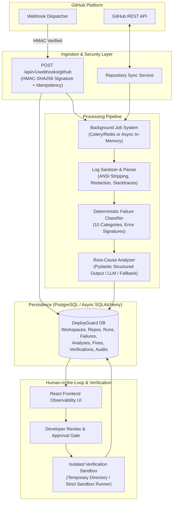

# DeployGuard — Architecture Plan & Implementation Roadmap

## 1. Executive Summary & Vision
DeployGuard is a production-grade CI/CD failure detection, root-cause analysis, and automated verification platform. It operates between GitHub Actions and software engineering teams to:
1. Ingest CI/CD failures via signed webhooks or repository synchronization.
2. Parse, sanitize, and extract structured diagnostic evidence from raw build/test logs.
3. Classify failures deterministically into 10 discrete engineering categories with transparent rule attribution.
4. Synthesize root causes using an extensible LLM layer (with deterministic offline fallback and strict prompt-injection defenses).
5. Generate minimal, validated patch proposals with zero automatic unapproved execution.
6. Verify fixes in an isolated execution sandbox comparing baseline vs candidate test results.
7. Record immutable audit logs, developer approval decisions, and authentic engineering analytics.

---

## 2. System Architecture & Component Interaction

---

## 3. Technology Stack Alignment

| Layer | Component | Chosen Technology |
|---|---|---|
| **Frontend** | Framework | React 19 + TypeScript + Vite |
| | Styling & Theme | Tailwind CSS (Dark Observability Palette, Lucide Icons) |
| | State & Routing | TanStack Query + React Router v6 |
| | Charts & Visuals | Recharts (real aggregated data, failure trends, category breakdowns) |
| | Forms & Validation | React Hook Form + Zod |
| **Backend** | API Engine | FastAPI + Python 3.13 |
| | Validation & Schemas | Pydantic v2 |
| | ORM & Persistence | SQLAlchemy 2.0 (Async) + Alembic migrations |
| | Database Engine | PostgreSQL (production) with dual-mode async SQLite for instant zero-dependency local runs and tests |
| | Background Jobs | Pluggable Queue: Celery + Redis, with embedded Async Task Queue for offline/single-instance mode |
| | Security & Auth | Argon2id password hashing, JWT Bearer sessions, Workspace Role-Based Access Control (RBAC) |
| **Analysis** | Log Sanitizer | Regex-based ANSI stripper, secret redaction, stack trace segmenter, hash fingerprinting |
| | Failure Classifier | 10 Deterministic Rules (Dependency, Syntax/Compilation, Test, Lint, Env, Config, Permission, Network, Timeout, Unknown) |
| | AI / LLM Engine | Provider-agnostic engine (OpenAI / Anthropic / Gemini / Local Ollama / Deterministic Fallback / Mock) |
| **Verification** | Sandbox Runner | Secure isolated test executor with allowlisted commands, timeout limits, path traversal rejection, no host credential leakage |

---

## 4. Database Schema Specification

1. **User**: `id (UUID)`, `email (unique)`, `password_hash`, `display_name`, `created_at`, `updated_at`.
2. **Workspace**: `id (UUID)`, `name`, `owner_id (FK User)`, `created_at`.
3. **WorkspaceMembership**: `workspace_id (FK)`, `user_id (FK)`, `role (Owner, Admin, Member)`, `created_at`.
4. **Repository**: `id (UUID)`, `workspace_id (FK)`, `provider (github)`, `external_repository_id`, `full_name`, `default_branch`, `installation_reference`, `connection_status`, `last_synced_at`, `created_at`.
5. **WorkflowRun**: `id (UUID)`, `repository_id (FK)`, `external_run_id (unique per repo)`, `workflow_name`, `branch`, `commit_sha`, `status`, `conclusion`, `started_at`, `completed_at`, `created_at`.
6. **Failure**: `id (UUID)`, `workflow_run_id (FK)`, `failed_job_name`, `category`, `severity`, `error_signature`, `summary`, `first_seen_at`, `last_seen_at`, `occurrence_count`, `status`.
7. **LogArtifact**: `id (UUID)`, `workflow_run_id (FK)`, `storage_reference`, `sanitized_excerpt`, `content_hash`, `created_at`.
8. **Analysis**: `id (UUID)`, `failure_id (FK)`, `status`, `provider`, `model`, `root_cause`, `evidence_json`, `alternatives_json`, `confidence`, `confidence_method`, `recommendations_json`, `token_usage`, `estimated_cost`, `duration_ms`, `created_at`.
9. **FixProposal**: `id (UUID)`, `analysis_id (FK)`, `status (draft, approved, rejected, applied)`, `patch_content`, `explanation`, `affected_files_json`, `approved_by (FK User)`, `approved_at`, `created_at`.
10. **VerificationRun**: `id (UUID)`, `fix_proposal_id (FK)`, `status (not_run, running, passed, failed, timed_out, cancelled, unavailable)`, `test_summary_json`, `exit_code`, `duration_ms`, `baseline_result`, `candidate_result`, `failure_reason`, `created_at`, `completed_at`.
11. **WebhookEvent**: `id (UUID)`, `provider`, `external_delivery_id (unique)`, `event_type`, `processing_status`, `received_at`, `processed_at`.
12. **AuditEvent**: `id (UUID)`, `workspace_id (FK)`, `actor_id (FK User)`, `action`, `resource_type`, `resource_id`, `metadata_json`, `created_at`.

---

## 5. Security & Sandbox Boundary Guarantees
- **No Arbitrary Shell Execution**: The verification service strictly enforces an allowlist (`pytest`, `npm test`, `python -m unittest`, `cargo test`, `go test`). Shell metacharacters (`|`, `&`, `;`, `$`, `` ` ``) are forbidden.
- **Path Traversal Defenses**: All proposed diffs and file targets are validated using canonical path checks. Any attempt to touch files outside the disposable project root (e.g. `../`, `/etc/passwd`, `C:\Windows`) causes immediate patch rejection.
- **Secret Redaction**: Build logs are processed through regex redaction replacing tokens, AWS keys, JWTs, and passwords with `[REDACTED_SECRET]`.
- **Credential Isolation**: Temporary test runners are stripped of environment variables containing tokens or keys.
- **Webhook Authenticity**: Webhooks require valid HMAC-SHA256 signature verification matching `X-Hub-Signature-256`. Deliveries with duplicate `X-GitHub-Delivery` IDs are acknowledged idempotently without re-triggering analysis.

---

## 6. Implementation Phases Breakdown

- **Phase 1: Foundation & Plan** (Complete): Environment assessment, architecture blueprint, directory structure.
- **Phase 2: Working Foundation**: Monorepo scaffolding, FastAPI backend, SQLAlchemy 2.0 Async, Pydantic v2 schemas, Argon2id auth, React frontend scaffolding with Tailwind dark developer UI.
- **Phase 3: Core CI/CD Ingestion**: GitHub service & Webhooks with HMAC verification, workflow models, repository synchronization, failure explorer.
- **Phase 4: Analysis Engine**: Log parser (ANSI stripping, secret masking, stacktrace isolation), deterministic failure classifier (10 categories), AI service with Pydantic JSON validation and deterministic fallback.
- **Phase 5: Fix Generation & Test Verification**: Safe diff generation, human approval gate, isolated sandbox runner, baseline vs candidate test comparison, audit trail.
- **Phase 6: Polish & Engineering Analytics**: Real metrics dashboard (failure rate, MTTR, category trends), live GitHub ingestion and developer observability UI.
- **Phase 7: Testing & Hardening**: Automated unit, integration, and E2E scenario tests (Scenarios A, B, C), type checks, and security assertions.
- **Phase 8: Documentation & Delivery**: README with Mermaid architecture, Docker Compose, `docs/architecture.md`, `docs/security.md`, `docs/evaluation.md`.
